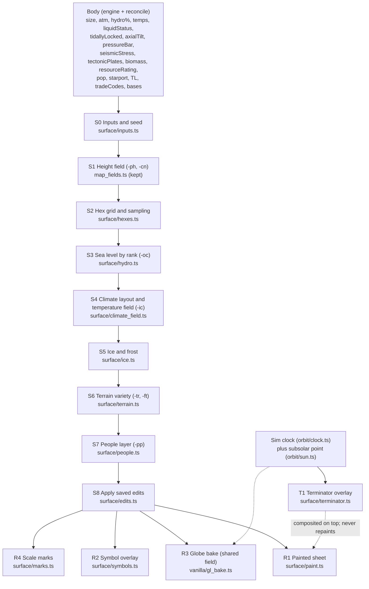

# Hybrid Surface Map: design for review

Status: **design only, for Johnny's review. No code has been changed.**
Date: 8 Oct 2026 (CT). Author: Grok Bot (review agent).

**Code this is based on**
- Lazarus `D:\webstorm\traveller_magnus`, working tree at `aeada0e`, read-only.
- Every file under `apps/web/src/surface/**` and `packages/engines/src/reconcile_environment.js` matched Lazarus byte for byte (MD5) on 8 Oct.
- Engine references are to the current working tree (`packages/engines/package.json` 1.1.0, uncommitted).
- TravellerWorlds ("TW") references are to the live site's scripts, fetched 8 Oct.

**Companion files**
- `/workspace/surface_map_review.md`: the earlier review.
- `/workspace/maps/*.png`: before renders of the three test worlds, with TW side by side.

**Conventions**
- Line numbers are 1-based.
- "TW `world_mapping.js` L865" means the live TravellerWorlds file.
- TW's repo (github.com/OjnoTheRed/T5-World-Builder) has **no license**, so this doc describes techniques only and copies no code.

---

## 1. Goals and non-goals

### Goals
1. **Keep our painted look.** Organic coasts, and water coverage within about 0.4 points of the hydro figure.
2. **Real per-hex data.** Every world gets a hex grid on the 20-triangle icosahedral layout, with a data record per hex that can be saved, edited and reloaded.
3. **Climate from the engine.** Use its temperatures, tidal lock, axial tilt, pressure and liquid, not from trade codes. Five layouts: normal, tidally locked (day / twilight / night), frozen, scorched, molten.
4. **Ice that looks right.** Ice on land and sea, sized by temperature, with ragged edges. Polar caps for rotating worlds; a night-side cap for worlds locked to their star.
5. **Surface variety.** Mountains, desert, tundra, jungle, swamp, volcanoes, craters and so on, driven by height, temperature, moisture, atmosphere and the engine's geology and biology fields. Trade codes add flavour only.
6. **A people layer placed after climate.** Starport, cities, towns, farmland, rural land, resources and estates, never on ice unless it is justified.
7. **Two styles.** Painted by default, with an optional TW-style terrain-symbol overlay. Scale marks on both.
8. **One model for map and globe**, so continents and ice match.
9. **Time on the map.** A moving day/night shadow (terminator) driven by the game clock, drawn as an overlay that never repaints the terrain (section 9).
10. **Stable seeds.** A name-independent seed and a cache key that includes the world data. Saved maps carry a version.

### Non-goals (for this design)
- No plate tectonics or erosion simulation, and no weather or clouds on the flat map.
- No change to the engine's UWP or temperature rules. Engine problems are reported (section 6.1), not fixed here.
- No copying of TW code or symbol artwork.
- No server-side map generation. Generation stays in the client worker; only saved edits go to the server, in Phase 4.
- Local terrain-hex maps (zooming into a world hex) are only made possible here, through the data model and seeds. Building them is later work.

---

## 2. What we keep, what we take, what we reject

### 2.1 Keep (ours)

| What | Where (current code) | Why |
|---|---|---|
| Value-noise fbm height field plus continent masks and domain warp | `vanilla/map_fields.ts` `buildGrid3D` L19, `fbm3D` L55, `buildContinentSeeds` L67, `continentHeight` L87 | Organic coasts, the main thing that looks better than TW |
| Sea level by CDF rank (hydro accuracy) | `map_fields.ts` `buildCDF` L146, `remapHeight` L160; `enhanced/map.ts` `seaSamples` L99, `seaRank` L108, `SEA_SAMPLES = 4096` L38 | Water fraction within about 0.4 points of hydro (earlier review, 400-system tally) |
| One seeded random stream per stage | `vanilla/map.ts` L65–71: `hashString(ms + '-' + imageSeed + '-ph' / '-cn' / '-oc')`, `mulberry32` L49 | Adding a stage never reshuffles the earlier ones |
| Latitude temperature profile `T = mean + A(1/3 − sin²lat)` | `enhanced/seas.ts` `latitudeTempK` L85, `amplitude` L54 | Bounded by the engine's low and high; one formula |
| Liquid identity from reconcile (`liquidStatus`, substance, melting point) | `enhanced/seas.ts` `substance` L72; `enhanced/liquids.ts` L13–33; `reconcile_environment.js` `phaseNotes` L254 | Exotic seas are drawn from data |
| Worker painting and chunked painting on the page | `surface.worker.ts`, `service.ts` `paintOnPage` L255, `createEnhancedMap` L230 | Keeps the UI smooth |
| Day/night geometry, already written and tested | `orbit/daynight.ts` `subsolarLongitude` L64, `subsolarLatitude` L73, `sunElevation` L82; tests `orbit_lineup.test.js` L402–419 | The terminator overlay builds on it (section 9) |

### 2.2 Take from TravellerWorlds (technique only)

| Technique | TW reference | How we adopt it |
|---|---|---|
| Icosahedral world map: 20 triangles, `size` hexes per edge, 10·size² + 2 hexes, two pole hexes | `world_mapping.js` `worldMap` L13, `numHexes` L23; `worldTriangle` L1828 | New `surface/hexes.ts` (section 4) |
| Terrain stored per hex, saved and reloaded exactly | `genSaveObj` L137, `loadObj` L161, `worldTriangle.saveObj` L1903 | `HexRecord` plus an edit layer (sections 5, 10) |
| Whole-world terrain modes (frozen, very hot, molten, tundra) | `frozenPlanet` L960, `veryHotPlanet` L987, `moltenPlanet` L1012, `tundra` L1037 | Climate layouts from **engine temperatures**, not trade codes (section 6) |
| Tidally locked layout: day side baked, night side ice, twilight band | `twilightZone` L1398, `getTwilightZone` L1721 | Temperature-driven version centred on the substellar point (section 6.4) |
| People layer from population, trade codes and extensions | `cities` L1143, `lowPopulTown` L1131, `arcologies` L1172, `rural` L1196, `cropLand` L1095, `starport` L1217, `resourceHexes` L1361, `nobleLand` L1292, `ruins` L757 (Di), `penal` L1241 | `surface/people.ts`, run **after** climate (section 7) |
| Feature sprinkles: mountains, chasms and precipices per triangle; craters on Va | `mountains` L706, `chasms` L725, `precipices` L745, `craters` L778 | Used as accents; their counts come from engine geology (section 5.3) |
| Scale marks: row and column numbers, latitude ticks, a hex labelled with the 1,000 km scale | `worldMap.outline` L289 onward (row labels near L380) | `surface/marks.ts` (section 8.4) |
| Zoom from a world hex to a terrain-hex map | `generateHexMap` L3565, `hexMap` L3651 | Seeds and records allow it later (section 10) |
| Reseed at one known point before the map | `planet_building_world_class.js` `createMap` L385–393 (`init_rng(me.seed)`) | Already ours per stage; we add a name-independent seed (section 10) |

### 2.3 Reject (do not copy)

| TW behaviour | Reference | Why we reject it |
|---|---|---|
| **Step order:** people before ice. Cities, rural land, crops and starport run before `icecaps` and climate. | `worldMap.generate` L100–135 (`cities` L115 … `icecaps` L124, `tundra` L128, `twilightZone` L129) | Towns and farms end up inside ice caps; visible in `/workspace/maps/comparison_coldwet.png` and `comparison_earthlike.png` |
| **Ice caps sized by hydro only:** `floor(hydro/2) − 1` rows, plus 1D rows for Ic | `icecaps` L870, L894 | Ignores temperature, atmosphere and tilt. A hot wet world gets caps; a cold dry one gets none. |
| **Whole-triangle flooding:** hydro × 2 triangles, then `seas()` adds more | `oceans1` L594–639, `seas` L854 | Blocky, and overshoots the hydro figure |
| **One shared random stream** for the whole page | `generic.js` `init_rng` L4; all stages call `dice()` | Any change upstream reshuffles the whole map |
| **Twilight geometry fixed to triangle columns** with hard-coded 85° day and night defaults | `getTwilightZone` L1723–1728, L1745, L1775 | Ignores the temperatures. Night-side ice even when the liquid would not freeze. |
| **Trade codes as climate drivers** (Fr, Tu, Vh, Mo, Tz) | L960–1037, L1398 | Our engine has real temperatures. Trade codes are flavour only (section 5.3). |
| The dead `systemZone == "I"` check | `icecaps` L868 | Dead code |

Note: TW's `Fl` (fluid oceans) code has **no** effect on its map. Its baked lands come only from Vh, Mo and the Tz day side (L1007, L1032, L1458). The red "baked lands" on TW's Wroclaw map come from Tz, not Fl.

---

## 3. Pipeline

### 3.1 Flowchart



### 3.2 Stages

| # | Stage | Inputs | Outputs | RNG stream | Owner (new or changed) |
|---|---|---|---|---|---|
| S0 | Inputs and seed | body, hexKey, dossierKey | `SurfaceInputs` (normalized numbers, liquid, layout hint), `seedKey`, `inputsDigest` | none | **new** `surface/inputs.ts`; changes `identity.ts` (use `enhancedSeedKey` L143) |
| S1 | Height field | seedKey | continuous `h(p)` on the unit sphere, CDF | `-ph`, `-cn` | kept: `vanilla/map_fields.ts` |
| S2 | Hex grid and sampling | size, `h(p)` | `HexGrid` (centres, neighbours, rows), per-hex `height`, `heightMax`, `waterFrac` | none (geometry) | **new** `surface/hexes.ts` |
| S3 | Sea level | hydroPercent, all samples | `seaRank`; per-hex `water` | `-oc` (palette jitter only, as now) | **new** `surface/hydro.ts` (logic moved from `enhanced/map.ts` L99–121) |
| S4 | Climate | temps, tidal lock, tilt, pressure, liquid | `layout`, per-hex `tempK` (annual mean), `twilight` | `-ic` (edge noise) | **new** `surface/climate_field.ts`; uses `enhanced/seas.ts` `latitudeTempK` |
| S5 | Ice and frost | per-hex temp, water, liquid, hydro | per-hex `ice` (`none` / `frost` / `seaIce` / `iceField` / `iceCap`) | `-ic` | **new** `surface/ice.ts`; replaces `enhanced/map.ts` `capShare` L158 and the caps branch of `sheetPlan` L182 |
| S6 | Terrain variety | temp, height, moisture, atm, biomass, geology, trade codes | per-hex `terrain[]` (base plus accents) | `-tr` (biome noise), `-ft` (features) | **new** `surface/terrain.ts` |
| S7 | People | pop, starport, TL, gov, trade codes, bases, extensions, resourceRating | per-hex `features[]` | `-pp` | **new** `surface/people.ts` |
| S8 | Edits | saved edit list | final `HexRecord[]` | none | **new** `surface/edits.ts` |
| R1 | Painted sheet | records, `h(p)` | RGBA pixels | none | **new** `surface/paint.ts`; `enhanced/map.ts` becomes a thin adapter |
| R2 | Symbols | records | vector symbols | `-sy` (symbol jitter only) | **new** `surface/symbols.ts` |
| R3 | Globe | records plus field | cube texture | none | changes `vanilla/gl_bake.ts`, `gl_shaders.ts` (section 8.3) |
| R4 | Marks | grid, size | labels and ticks | none | **new** `surface/marks.ts`; changes `vanilla/map_grid.ts` |
| T1 | Terminator | clock, body, grid | overlay alpha | none | **new** `surface/terminator.ts`, `orbit/sun.ts` (section 9) |

### 3.3 Determinism rules
1. **Stream seeds.** Every random stream is `mulberry32(hashString(master + '-' + seedKey + '-' + tag))`. Tags: `ph`, `cn`, `oc` (existing), plus `ic`, `tr`, `ft`, `pp`, `sy` (new). A stage may use **only** its own streams.
2. **No ambient randomness.** No `Math.random`, `Date.now` or `performance.now` inside S0–S8 (timing belongs only to the chunk scheduler). The time overlay T1 reads the clock but changes no state.
3. **Fixed iteration order.** Always iterate hexes by `id` ascending (section 4.2). Shuffles use Fisher–Yates on that stream.
4. **Quantize before thresholds.** Values that feed a threshold (temperature, height, moisture) are rounded to 1e-6 before comparing, so last-bit differences in `Math.sin` between browsers cannot flip a hex. Ties go to the lower `id`.
5. **Stages never read later stages.** S7 sees S4–S6 output but never the reverse. Edits (S8) are applied last and never feed back into generation.
6. **Version in the cache key.** A change to any stage's logic bumps `SURFACE_ENGINE_VERSION` (section 10.4). The determinism tests pin digests per version.

---

## 4. Hex grid geometry and addressing

### 4.1 Shape
- **Grid.** Hex centres are the vertices of a frequency-*n* geodesic icosahedron, with *n* = UWP size digit (1–15). The 20 faces are split into an *n*-step triangular lattice and pushed out to the unit sphere.
- **Count.** That gives **10n² + 2** cells. Twelve are pentagons: the two poles plus ten at icosahedron corners, in rows *n* and *2n*. This is the same count TW computes (`world_mapping.js` L23).
- **Hex width.** The equator row has 5n hexes. With MgT2E size *s* = 1,600·s km diameter, a hex is π·1,600·s / (5s) ≈ **1,005 km** across at every size. So the "1,000 km" scale mark is one hex, as on TW's legend.
- **Size 0 / asteroid belts.** No map, as today (`identity.ts` `canMapWorld`).

| Size | 1 | 2 | 3 | 4 | 5 | 6 | 7 | 8 | 9 | A | F |
|---|---|---|---|---|---|---|---|---|---|---|---|
| Hexes | 12 | 42 | 92 | 162 | 252 | 362 | 492 | 642 | 812 | 1,002 | 2,252 |

### 4.2 Addressing
- **Rows.** `row` runs 0…3n from the north pole: row 0 is the north pole hex, row 3n the south pole hex.
- **Row length L(r):**
  - 1 at the poles;
  - 5r for 1 ≤ r ≤ n (north triangles);
  - 5n for n ≤ r ≤ 2n (equatorial band);
  - 5(3n − r) for 2n ≤ r < 3n (south triangles).
  - The sum is 10n² + 2.
- **Columns.** `col` runs 0…L(r)−1, eastward from longitude −180°. This matches the current sheet, where x = 0 is −180° and the centre is longitude 0 (`map_projection.ts` L50, `lobeCenLon = −π + li·lobeLon`).
- **id.** `id = rowStart[r] + col`, a dense integer. It is the iteration order (rule 3.3.3) and the save key.
- **Derived address.** `face` (0–19) and lattice `(i, j)` are derived for rendering and lookup. A vertex on a shared edge belongs to exactly one face (the west or north one), so no hex is stored twice.
- **Neighbours.** Built once per size by geometry: the 5 or 6 nearest centres by angle, kept in a frozen `Int32Array`, and cached for the 15 sizes. Tests check symmetry, 12 pentagons and 6 neighbours everywhere else. Doing it geometrically avoids hand-written seam rules, the usual source of icosahedral-grid bugs. It also gives correct neighbours across triangle seams and around the poles.
- **Area.** Normalized geodesic cells are not quite equal in area: the largest/smallest ratio rises with *n*. Each hex therefore stores `area` (its solid angle / 4π). Every coverage figure (water, ice) is area-weighted.

### 4.3 Net layout (display)
- **Same zig-zag outline as now.** Five north triangles with apexes at the top, a band of ten triangles, five south triangles with apexes at the bottom.
- **The icosahedral band is narrower.** It spans latitudes ±26.57° (atan ½), not the current ±30° (`POLE_FRAC = 1/3`, `map_fields.ts` L6).
- **Pixel to sphere.** For a pixel in face *f*, take its barycentric weights (w0, w1, w2); the sphere point is `p = normalize(w0·A + w1·B + w2·C)` (gnomonic within the face).
  - Adjacent faces share edge vertices, so the mapping is **continuous across every seam**.
  - All five north apexes map to the same pole. This fixes the polar crop by construction.
- **Pixel to hex.** Round `(n·w1, n·w2)` to the nearest lattice point of the face, then use a per-face `vertexId` table. Constant time per pixel.
- **Seam hexes.** A hex on a net seam is drawn as two half-hexes, one on each side, as TW draws them. The record is the same.

### 4.4 How pixels are sampled into hexes (S2)
- **Seven samples per hex:** the centre plus 6 points on a ring at 0.45 × the hex spacing, each through the kept `continentHeight` → `remapHeight`.
  - `height` is the area-weighted mean.
  - `heightMax` is the max (for peaks).
  - `waterFrac` is the share of samples below `seaRank`.
- **`water = waterFrac ≥ 0.5`.** Area-weighted hex water must stay within ±max(1.5 points, one hex's area) of `hydroPercent`. If it does not, the 1–2 boundary hexes with the closest `waterFrac` are flipped, in `id` order, until it does. This is deterministic.
- **The painted sheet keeps per-pixel coasts.** A pixel is water if `h(p) < seaRank`, exactly as now, so coasts stay organic. The hex flag drives symbols, people and climate, not the coastline.

### 4.5 Projection fix (Phase 0, on the current diamond)
- **The bug.** `map_projection.ts` L54 (north) and L103 (south) compute `lonFrac = (px − cx) / hw`. `maxOff` is the half-width of the row actually painted, `hw·py/bandTop` (L46) and the south equivalent (L95), so near the tips only a sliver of each lobe's longitudes is sampled.
- **Fix:** `lonFrac = maxOff > 0 ? (px − cx) / maxOff : 0` at both sites. Each lobe row then covers its full 72° of longitude. This recovers the ~17% of the sphere never drawn: 50% of longitudes are missing at 60°, 75% at 75°.
- **Effect on vanilla parity.** The vanilla sheet is pinned to the legacy renderer by SHA-256 digests (`tests/web/surface_map.test.js` L41). See open question Q2.
- **The fix is a prerequisite for the terminator overlay (section 9).** On the cropped projection the shadow would jump at every polar-triangle edge.

---

## 5. Per-hex data model and terrain table

### 5.1 Records

```ts
// surface/hex_types.ts (new)
export type HexId = number;                    // rowStart[row] + col
export type IceKind = 'none' | 'frost' | 'seaIce' | 'iceField' | 'iceCap';
export type Layout = 'normal' | 'locked' | 'frozen' | 'scorched' | 'molten' | 'airless';

export interface HexRecord {
  id: HexId;
  row: number; col: number;                    // 4.2
  face: number;                                // 0..19, for rendering
  lat: number; lon: number;                    // degrees, hex centre
  area: number;                                // share of the sphere, sums to 1
  height: number;                              // 0..1 after CDF remap (mean of 7 samples)
  heightMax: number;
  waterFrac: number;                           // 0..1, from samples
  water: boolean;
  liquid: string | null;                       // reconcile substance, e.g. 'Water', 'Sulphur Dioxide'
  tempK: number;                               // annual-mean surface temperature, lapse rate included
  moisture: number;                            // 0..1
  ice: IceKind;
  twilight: boolean;                           // locked layout only: in the terminator ring
  terrain: TerrainCode[];                      // [0] = base, rest = accents (max 3)
  features: FeatureCode[];                     // people layer
  edited?: true;                               // set by S8 only
}

export interface SurfaceMap {
  version: string;                             // SURFACE_ENGINE_VERSION, e.g. 'surface-2.0.0'
  seedKey: string;                             // enhancedSeedKey(hexKey, dossierKey)
  inputsDigest: string;                        // sha-256 of the normalized SurfaceInputs (10.2)
  size: number; layout: Layout;
  substellar: { lat: number; lon: number } | null;  // locked worlds only
  hexes: HexRecord[];                          // length 10n²+2, index == id
}

export interface HexEdit {                     // saved; generation never reads these
  id: HexId; terrain?: TerrainCode[]; features?: FeatureCode[]; ice?: IceKind; note?: string;
}
```

**Serialization.** One byte per terrain code plus a feature bitmask, then run-length encoding by `id`. A size-8 world (642 hexes) is about 1–2 KB; a size-F world is under 6 KB. The saved form stores only `version`, `seedKey`, `inputsDigest` and the **edits**. The rest is regenerated (section 10).

### 5.2 Base terrain table
Definitions:
- *T* is the hex `tempK`; *Tm* and *Tb* are the liquid's melting and boiling points (water 273 / 373).
- *e* = land elevation above sea, (height − seaRank)/(1 − seaRank).
- *m* = moisture.
- *life* is true when the engine gives `biomass` > 0 (`mgt2e_world_engine.js` L2405–2436). Without it, the fallback is the profile rule in `profile.ts` L191–192 (atm 4–9, hydro ≥ 2, −25 °C to 50 °C), flagged "assumed".

The first matching row wins, in order. Ice (S5) is decided before this table and takes priority for `iceCap` / `seaIce` / `iceField`.

| Code | Name | Rule | Painted colour (RGB) | Symbol (our own artwork) |
|---|---|---|---|---|
| `LV` | Lava sea / lava field | layout `molten`, or a volcano neighbour with T > 1,000 K | 220 72 10 → 88 18 6 | Glowing cracks |
| `OC` | Ocean (deep) | water, not frozen, depth > 0.35 | liquid deep colour (`enhanced/map.ts` `seaColours` L60) | Plain fill |
| `SH` | Shallows / coast | water, not frozen, depth ≤ 0.35 | liquid shallow colour | Light fill, wave tick |
| `SI` | Sea ice | water, `ice=seaIce` | 236 240 246 (`PALE_SHALLOW`, `enhanced/map.ts` L70) | Pale fill, crack lines |
| `IF` | Ice field (frozen sea plain) | water, `ice=iceField` | 214 224 236 | Cross-hatch |
| `IC` | Ice cap (glacier) | land, `ice=iceCap` | 244 247 252 | Dome lines |
| `FR` | Frost / frozen land | land, `ice=frost`, or T < Tm − 5 with hydro ≤ 1 | 196 204 212 over rock | Stipple |
| `TU` | Tundra | land, Tm − 5 ≤ T < Tm + 5, life | 150 156 128 | Short tufts |
| `BK` | Baked lands | land, T > max(Tb, 340 K), or the locked day side above Tb | 196 92 48 | Heat ripples |
| `DE` | Desert | land, m < 0.22, T ≥ Tm + 5 | 202 165 88 | Dunes |
| `SW` | Swamp / wetland | land, life, m > 0.8, e < 0.08, T > Tm + 2 | 92 112 70 | Reeds |
| `JU` | Jungle | land, life, T > 295, m > 0.65 | 46 102 52 | Dense crowns |
| `FO` | Forest | land, life, 278 < T ≤ 295, m > 0.5 | 70 110 62 | Tree crowns |
| `TA` | Taiga | land, life, Tm + 5 ≤ T ≤ 278, m > 0.4 | 78 100 80 | Conifers |
| `GR` | Grass / steppe (clear) | land, life, otherwise | 150 150 92 | Blank |
| `XR` | Exotic terrain | land, atm 10–12, no life | rock tinted by `enhanced/liquids.ts` sea hue | Swirl |
| `RG` | Regolith (airless) | land, atm 0–1 | 120 116 112 | Small craters |
| `RK` | Bare rock | land, no life, otherwise | land stops of `map_palette.ts` L193–205 **without** the white top stop | Blank |

**White peaks** (Phase 0 bug). Today the land stops end with a fixed near-white top stop, `{ t: 1.0, c: [222,228,240] }` (`map_palette.ts` L205). Every high interior paints white even at the equator (visible in `/workspace/maps/earthlike_*.png`). In the new model, snow on peaks is only the `IC` / `FR` ice result after the lapse rate is applied. The top stop becomes rock grey.

### 5.3 Accents (terrain[1..3]) and trade-code flavour

| Accent | Rule (engine data first) | Count / placement | Stream |
|---|---|---|---|
| `MT` Mountains | e ≥ 0.70 (the top 30% of land by height) | all qualifying hexes | none |
| `VO` Volcano | engine `seismicStress` (L2360) | `round(seismicStress / 3)`, capped at 5% of land hexes; on mountain or plate-boundary hexes | `-ft` |
| `RI` Rift / chasm | plate boundaries: Voronoi of `tectonicPlates` (L2456) seeds; diverging pairs (`MGT2E_PLATE_INTERACTIONS`, `core/constants.js`) | boundary hexes; converging pairs add `MT` instead | `-ft` |
| `CR` Crater | atm ≤ 1, or trade code Va | size + 1D per world, on land | `-ft` |
| `PR` Precipice | e jump > 0.35 to a neighbour | all qualifying | none |
| `RU` Ruins | trade code Di (TW `ruins` L757) | 1D hexes near the best habitable land | `-pp` |

**Trade-code flavour** changes weights, never the climate class:
- **De** raises the desert threshold to m < 0.35.
- **Ic** marks every frozen-sea hex as `iceField`.
- **Fl** tints the sea and exotic terrain.
- **Va** suppresses `life`.
- **Po** shifts moisture down 0.1.
- **Ga** and **Ag** raise moisture by 0.05 near the coast.

**If the engine and the trade codes disagree** (for example Fr on a 290 K world), the **engine wins** and the caption notes the mismatch. Whether to honour TW-style trade-code layouts instead is open question Q4.

---

## 6. Climate and ice

### 6.1 What the engine provides (read-only check of the Lazarus working tree, engine 1.1.0, 8 Oct)

| Field | Where set (`packages/engines/src/mgt2e_world_engine.js`) | Used for |
|---|---|---|
| `meanTempK` | provisional at L770 in `generateAtmospherics` (albedo 0.3); final at L1749 in `generateRotationalDynamics`; geology recompute L2370 | Every layout |
| `highTempK`, `lowTempK` | L1755–1756 (= mean), then L1785–1786, from luminosity ± `lumMod`; recomputed L2396–2397 | Spread; locked day and night |
| Spread terms | tilt `tfactor` L1757–1759; rotation `rfactor` L1761 (forced to 1 for a lock, L1767–1770); hydro and surface-distribution `gfactor` L1772–1774; pressure damping `afactor = 1 + pressureBar` L1776–1778 | Explains why thick air already narrows high/low |
| `axialTilt` | L1658; locked jitter (2D−2)/10 ° at L2097 | Seasons and caps |
| `tidallyLocked` | default false L1602; set L2095 | Layout choice |
| `isTwilightZone` | L1679 / L1690 and L2115 / L2133 (planets only; moons false, L2120) | Layout choice |
| `siderealHours`, `solarDayHours`, `yearHours`, `periodDays` | L1626, L1678–1688, L1669, L2259 | Terminator clock (section 9) |
| `surfaceDist` | L1448, from `MGT2E_SURFACE_DISTS` (`core/constants.js` L199: "Extremely Dispersed" … "Extremely Concentrated") | Continent mask weight (S1 option, Phase 2) |
| `seismicStress`, `tectonicPlates` | L2360, L2440–2456 | Volcanoes and rifts |
| `biomass`, `biocomplexity`, `resourceRating` | L2405–2530, L2423 / L2621 | Vegetation, resources |
| Liquid melting and boiling points | engine data `generated/rules/mgt2e_data.js` L751 (e.g. Sulphur Dioxide `bp: 263, mp: 201`) | Ice and boiling thresholds |

**What is missing.**
- There are **no explicit day-side / night-side (substellar / antistellar) temperatures** and no heat-transport coefficient. A search for `dayTemp|nightTemp|substellar|terminator` in `packages/engines/src` finds nothing. For a locked world the map therefore reads `highTempK` as the substellar temperature and `lowTempK` as the antistellar one. This is an approximation: the engine's high and low come from a generic luminosity swing (L1780–1786), not a day/night energy balance. See Q7.
- The map's own liquids table (`enhanced/liquids.ts` L13–33) has `meltingK` only. Phase 2 adds `boilingK`, taken from the same engine table, and a test keeps the two in step, as `surface_seas.test.js` already does for melting points.

**Water vs Ice is still decided before the temperature exists. This is fact, checked on Lazarus.**
- `generateAtmospherics` (L743) sets `w.liquidType = "Water"` at L1449, then at **L1452** tests `if (w.highTempK < 273 || w.atmCode === 0 || w.atmCode === 1)` to switch to `"Ice"` (L1453).
- `highTempK` is first assigned later, in `generateRotationalDynamics` (L1580): L1613 (null, no-atmosphere branch), L1755, L1785. The geology pass recomputes it at L2396.
- `mgt2e_topdown_generator.js` calls `generateAtmospherics` at **L121** before `generateRotationalDynamics` at **L126**. The repair path at L315–316 re-runs only the rotational dynamics, never the liquid decision.
- So on a fresh generation, `highTempK` is `undefined` at L1452. The comparison is false, and **every cold world with atmosphere ≥ 2 is labelled "Water"**. Only atm 0/1 gets "Ice".
- The exotic-liquid branch (L1457–1471) filters by `meanTempK`, which exists only as the provisional L770 value.
- `git diff packages/engines/src/mgt2e_world_engine.js` on Lazarus has **no** added or removed lines touching `liquidType`, `highTempK` or `Ice`. The 1.1.0 UWP edits did not target this.
- Reconcile then marks these worlds unresolved and the map paints them purple (earlier review, O1–O3, commit `0b96b80`). **The map's Phase 0 fix (section 11) works without an engine change.** The engine fix belongs to whoever owns `packages/engines`.

### 6.2 Layout selection (S4)
Applied in order. A world has one temperature **profile** (`normal` or `locked`); the other labels are outcomes or flags.
1. **`molten`.** Hydro code F, or hydro 0 with mean > 1,000 K (kept from `map_palette.ts` L83–84). Everything is lava and baked land; no ice. Stop.
2. **`airless` flag.** atm 0–1. Regolith and craters. Ice is only frost in cold traps, when the engine's liquid is Ice (engine L1452 forces "Ice" for atm 0/1).
3. **Profile.**
   - **`locked`** when `!isMoon && (tidallyLocked || isTwilightZone)`. This is the same test as `enhanced/seas.ts` `lockedToStar` L48–51 and `orbit/daynight.ts` `turningOf` L40.
   - **`normal`** otherwise.
   - A moon locked to its planet still has a day and night under the star (Johnny's Q1 ruling, `daynight.ts` L12–15). It uses `normal`.
4. **Outcome labels from the profile.**
   - **`frozen`:** the profile's warmest point < *Tm*.
   - **`scorched`:** its coldest point > *Tb*, or there is no liquid and the mean is > 373 K.
   - These are captions and palette hints, not separate generators. That avoids TW's trade-code switches.

Every threshold uses **one** temperature source: the engine's mean, low and high through the profiles below. The vanilla band word (`identity.ts` `worldMapData` L71–72) and `enhancedWorldData`'s band override (`enhanced/climate.ts` L51–55, which sets `temperatureK: 0`) are no longer used by the hybrid map. This removes the earlier review's "two temperature sources" problem (O5).

### 6.3 Rotating worlds: polar caps by temperature and tilt
For a hex at latitude φ (degrees) with land elevation *e*:

```
A      = min(1.5·(mean − low), 3·(high − mean))                     (seas.ts amplitude, L54)
A_eff  = A · clamp((54 − tilt_eff)/9, −1, 1)       tilt_eff = tilt > 90 ? 180 − tilt : tilt
T_lat  = mean + A_eff · (1/3 − sin²φ)                               (seas.ts latitudeTempK, L85)
Δs     = 0.5 · tiltPart(tilt, yearHours) · |sin φ| · (high − low)/2   (tiltPart: orbit/today_temp.ts L23,
                                                                      a copy of engine L1757–1759)
T_hex  = T_lat − Γ·e + σ·n_ic(p)                    Γ = 28 K, σ = 3 K
```

- **Lapse rate Γ = 28 K.** The same as the globe shader's `- e * 28.0` (`vanilla/gl_shaders.ts` L246–247), so map and globe agree on snowy peaks.
- **High tilt.** For tilt ≥ 54° the poles get more sunlight per year than the equator. A_eff changes sign by 63°, giving an **equatorial ice belt** instead of caps. Tilts below 45° are unchanged.
- **Ragged edge.** `n_ic` is a 3-octave fbm on the `-ic` grid, in −1…1. It gives a ragged edge instead of today's ruler-straight latitude line with a 3° blend (`CAP_BLEND_DEG = 3`, `enhanced/map.ts` L40).

**Ice classes (S5).**

| Hex | Condition | Ice |
|---|---|---|
| water | T_hex < *Tm* | `seaIce` |
| water | *Tm* ≤ T_hex < *Tm* + Δs | `seaIce`, seasonal (painted lighter) |
| land | T_hex < *Tm* − 5 and hydro ≥ 4 (or moisture > 0.5) | `iceCap` |
| land | T_hex < *Tm* − 5 and hydro 1–3 | `frost` |
| land | T_hex < *Tm* − 5 and hydro 0 | none: bare rock or regolith |
| land | *Tm* − 5 ≤ T_hex < *Tm* + 5 | none; the terrain table gives `TU` (tundra) or `FR` |

- **Other liquids.** For an exotic sea, *Tm* is that liquid's melting point, and the ice colour is its paled sea colour (`enhanced/map.ts` `paledSeaColours` L86).
- **Fixes.** This replaces the sea-only cap (`sheetPlan` L182 → `capShare` L158). Ice now lies on land as well, so land under a cap is no longer bare brown (earlier review). The vanilla `polarAngle` band-word table (`map_palette.ts` L95–103) is retired for the hybrid map.

### 6.4 Tidally locked worlds: the ice cap sits on the night side
**Where the star is.**
- **Substellar point:** (lat 0°, lon 0°). The existing convention puts a locked planet's subsolar longitude at 0: `spinAngle` returns `starAngle` (`daynight.ts` L49), so `subsolarLongitude` is 0 (L64–66). The test is `orbit_lineup.test.js` L402.
- The engine gives locked worlds 0–1° of tilt (L2097), so the latitude is taken as 0.
- **Antistellar point:** (0°, 180°).

**Where those points sit on the 20-triangle net.**
- Longitude runs from −180° at x = 0 to 0° at the sheet centre.
- The north apexes sit at −180°, −108°, −36°, +36° and +108°; the south apexes are 36° east of each.
- The **substellar point** is on the equator at the centre line of the band's upward-pointing triangle whose base rests on south triangle 2, directly above that triangle's apex longitude.
- The **antistellar point** is at ±180°, the longitude of north apex 0. It lies in the downward-pointing band triangle under north triangle 0, which the net splits between the left and right edges.
- With the default orientation the **night cap is cut in two by the sheet's wrap edge**. A display-only "centre on" option (night side, which is TW's choice; day side; or starport) rotates the net's longitude origin without changing any record. See Q6.

**Temperature profile.**
- With θ the angle from the substellar point and *c* = cos θ:

```
S      = (high − low) / 2                       (engine high = substellar, low = antistellar; see 6.1)
w      = 0.2 + 0.3·min(1, P/3)                  P = pressureBar; heat transport widens the transition
g(c)   = tanh(c / w) / tanh(1 / w)              odd in c, so the area mean of T stays = meanTempK
T_hex  = mean + S·g(c) − Γ·e + σ·n_ic(p)
twilight ring: |θ − 90°| ≤ δ,   δ = 5° + 20°·min(1, P/3)
```

- **Thicker air** gives a larger *w* (a gentler gradient, so more of the night side stays near the mean) and a wider twilight ring. The engine has already shrunk *S* through `afactor` (L1776–1778). Together, **thick atmospheres widen the twilight band and shrink the night ice.**

**What each region gets.**
- **Night cap.** Hexes with T_hex < *Tm*, centred on the antistellar point.
  - Sea becomes `seaIce`.
  - Land becomes `iceCap` if hydro ≥ 4; `frost` on bare rock if hydro 1–3; **bare rock with no ice** if hydro 0. Dry worlds get frost, not thick ice.
  - **Cold-trap bonus:** if the antistellar temperature is below *Tm* − 40 K and water exists, the land class goes up one step (frost becomes iceCap). Volatiles collect on a permanent night side.
- **Day side.**
  - Sea hexes with T_hex > *Tb* boil dry and become `BK` with a salt-flat tint (evaporite basins). Land above *Tb*, or above 340 K, is `BK`.
  - Otherwise the normal terrain table applies; the day side is usually dry, so expect `DE`.
- **Twilight ring.** The most habitable band. The people layer prefers it (section 7).
- **No polar caps.** The poles sit at θ = 90°, inside the twilight ring.

**How TW does it (for comparison).**
- `twilightZone` (`world_mapping.js` L1398) has a hand-placed size-1 case (L1404–1468). For other sizes it calls `getTwilightZone` (L1721).
- That uses default **85° night and 85° day extents** (L1723, L1726), converted to hex columns as size·2.5·(90 − deg)/90 (L1737).
- It anchors two **vertical column strips** 180° apart: the first column of triangle 4 (west, L1745) and the last column of triangle 15 (east, L1775).
- Between the strips is night. Ice fields lie near the terminator and ice cap deeper than size/2 columns in (L1479–1520). Outside the strips is day: ocean becomes desert, land becomes baked lands.
- **Temperature, liquid and hydro are never consulted.** Night-side ocean always becomes ice, and column strips are not great circles near the poles.
- Ours uses the true 3-D angle from the substellar point, so the terminator is a great circle (a curve on the net), and the ice follows the liquid's real melting point.

**Current code.** `enhanced/seas.ts` returns `kind: 'locked'` (L133–138). `enhanced/map.ts` L219–222 then draws **no** ice (TODO "locked worlds"). The globe shader already shades locked worlds day-to-night along +x (`gl_shaders.ts` L245–246, `uMeanC + uSpread·0.6·d.x`). Phase 2 must put the substellar point on the same axis (section 8.3).

### 6.5 Worked examples (the three rendered test worlds)
Numbers come from the formulas above. Area shares are of the whole sphere (polar: 1 − sin φ for both caps; locked: (1 ± cos θ)/2). Hex counts = share × (10n² + 2). The temperatures are the test bodies used for `/workspace/maps/*.png`, entered by hand; the engine was not run.

**(a) Earthlike, A867977-C.** Size 8 (642 hexes); mean 288, low 255, high 305 K; tilt 23°; 1 bar; hydro 72%.

| Quantity | Value |
|---|---|
| A, T at equator, T at pole | 49.5; 304.5 K; 255 K |
| Permanent sea ice (T < 273) | poleward of **52.9°**: 20.2% of the sphere, about 130 hexes, of which about 94 are sea |
| Seasonal sea-ice fringe | to **48.6°** (25.0% of the sphere) |
| Land ice cap (T < 268) | poleward of **59.2°** (14.1%) |
| Tundra band (268–278 K) | 47.0°–59.2° |
| Snow on peaks (e = 0.8, so −22 K) | only poleward of **~33°**: no white equatorial mountains |

*Expected look:* blue seas and green/brown land with forest, grass and desert variety by moisture. Ragged white caps over **land and sea** beyond about 53–59°, a lighter seasonal fringe, snowy peaks only at mid and high latitudes, cities on temperate coasts. Today's render (`earthlike_enhanced.png`) shows bare brown land under a sea-only cap with a straight edge, and white equatorial highlands.

**(b) Cold wet, C767543-7.** Size 7 (492 hexes); mean 262, low 240, high 282 K; 1 bar; hydro 70%; engine label "Water".

| Quantity | Value |
|---|---|
| A, T at equator, T at pole | 33; **273.0 K**; 240 K |
| Sea ice | everywhere except open leads where noise lifts T above 273: scattered within about ±15° of the equator |
| Land ice cap (T < 268) | poleward of **22.9°** (61% of the sphere) |
| Equatorial land | tundra or frost (268–273 K); taiga only on warm, wet lowlands if the engine gives biomass |

*Expected look:* a white and pale-blue world with a few dark open-water leads on the equator, ice-covered continents beyond ±23°, and tundra-brown equatorial coasts. **No purple.** Today the default sheet paints it "Unknown Exotic Liquid" purple with no ice (`coldwet_enhanced.png`). That comes from the engine ordering in 6.1, then reconcile's "unresolved", then `seaPlan` L328–336.

**(c) Wroclaw, B6A58C8-B, M2 V.** Size 6 (362 hexes); atm A (exotic); reconciled liquid **Sulphur Dioxide** (mp 201 K, bp 263 K); test temperatures mean 250, low 230, high 268 K; P assumed 1 bar; hydro 50%.
- **Case 1, the engine says it rotates.** A = 30, so T runs 260 K at the equator to 230 K at the pole. That never reaches 201 (freezing) or 263 (boiling): **no ice and no dry basins**. Liquid SO₂ seas, exotic-tinted barren land (`XR`), mountains, and volcanoes if `seismicStress` is high. Like today's enhanced sheet, without the purple coastal fringe.
- **Case 2, locked.** Likely for an M2 V habitable-zone world, but it depends on the engine roll (L2003–2122).

| Quantity | Value |
|---|---|
| S, w, δ | 19 K; 0.30; ±11.7° |
| Substellar, antistellar T | 269 K; 231 K |
| Night freeze (T < 201) | **none**: 231 K is above SO₂'s melting point, so **no night ice cap** |
| Day-side boiling (T > 263) | θ < **75.5°**: 37.5% of the sphere, about 136 hexes. Seas there are dry evaporite basins; land is baked. |
| Twilight ring | θ 78.3°–101.7°: SO₂ shorelines, the preferred band for the people layer |
| Night side | liquid SO₂ seas and cold rock |

*Contrast with TW:* TW's Wroclaw shows a night-side ice cap and ice fields (`wroclaw_travellerworlds.png`), because its twilight layout always freezes night-side ocean.
- **Case 2′, the same locked world if its sea were water.** The whole world is below 273 K, so every sea is frozen. Land glacier (T < 268) covers θ > 57.7° (76.7% of the sphere), a **thick night-centred cap reaching well into the day side**. A frost-free rocky patch of about 23% surrounds the substellar point. This is the "ice on the night side, not at the poles" Johnny saw on TW, but sized by temperature.

**Generic locked water worlds** (size 7, mean 280 K), showing the pressure and hydro effects:

| P | low / high (K) | Night sea ice from | Night land glacier from | Twilight ± |
|---|---|---|---|---|
| 0.1 bar, hydro 1 | 200 / 360 | θ > 91.1° (49.1%) | **frost only** (hydro 1) | 5.7° |
| 1 bar, hydro 6 | 240 / 320 | θ > 93.0° (47.4%, about 233 hexes) | θ > 95.3° (45.4%) | 11.7° |
| 3 bar, hydro 6 | 250 / 310 (the engine damps the spread) | θ > 96.6° (44.3%) | θ > 101.7° (39.8%) | 25° |

---

## 7. People layer (S7: runs after ice and climate)

**Inputs.**
- Population digit *P*, starport class, TL, government, trade codes, and `bases` if present.
- `resourceRating` (engine L2423 / L2621).
- T5 extensions (Ix, Ex, Cx, nobility) **only if the body carries them**, for example travellermap imports. Our MgT2E engine produces none of them.

**Habitability per land hex.**

```
H = clamp(1 − |T_hex − 293| / 40, 0, 1) · (moisture ≥ 0.2 ? 1 : 0.5) + 0.2·coastal + 0.3·twilight(locked)
```

`H = 0` on `iceCap`, `seaIce`, `BK` and `LV`.

**Counts and placement rules.**

| Feature | Count | Placement | TW technique it borrows |
|---|---|---|---|
| Starport (A–E) | 1 | Highest-H coastal land hex. On a **locked** world it must be in the twilight ring. | `starport` L1217 |
| Major city | P ≥ 9: one per triangle face with land (≤ 20). P = 8: half of those faces, rounded up. | Best-H hex in each chosen face; cities at least 2 hexes apart | T5 "one city per triangle if pop > 7" (TW `cities` L1143; the author's rules doc) |
| Arcology | P ≥ 10: one per two cities | Next to a city | `arcologies` L1172 |
| Town | P 4–7: P − 3 towns. P 1–3: one outpost. | Best remaining H | `lowPopulTown` L1131 |
| Rural | P ≥ 6: ring-1 neighbours of cities and towns with H ≥ 0.3, capped at 15% of land | — | `rural` L1196 |
| Farmland | Ag: 15% of habitable land. Ga / Ri, or P ≥ 6 with life: 6%. Na: none. | *Tm* + 5 ≤ T ≤ *Tm* + 35, moisture ≥ 0.3; not `DE` / `BK` / ice | `cropLand` L1095 |
| Resources | max(0, ⌊(resourceRating − 4)/2⌋). A T5 Ex resources digit overrides it if present (Q5). | On `MT` / `VO` / `CR` / `RI` hexes | `resourceHexes` L1361 |
| Bases | From `bases` (N, S, W, D…) | Next to the starport | — |
| Ruins | Di: 1D | Former best-H hexes | `ruins` L757 |
| Noble estate, penal colony | Only from imported T5 data (nobility; Px / Pe) | Best-H hex not yet used | `nobleLand` L1292, `penal` L1241 |

**Constraints (checked by tests).**
1. **Order.** S7 runs after S4–S6 and never changes terrain or ice.
2. **Never on ice, unless justified.** That means:
   - (a) no non-ice land exists, or
   - (b) the atmosphere is unbreathable (codes 0–3, A+), so settlements are domed anyway and the hex is next to a resource, or
   - (c) a referee edit.
   Rule (b) also sets `domed` on the feature.
3. **Never on water**, except on Wa / Oc worlds: floating cities on `SH` hexes.
4. **At most one major feature per hex** (starport, city, arcology, town). Rural, farmland and resources can stack with each other.
5. **Ties** go to the lowest `id`. Shuffles use the `-pp` stream only.
6. **Starport longitude on rotating worlds.** The day/night code defines the starport as standing on longitude 0 (`orbit/daynight.ts` L61–62, L93–95). The hybrid map does not move terrain to honour this. It records `starportLon`, and the terminator and the starport tick (section 9) measure longitude from it. Locked worlds have no starport tick (`starportTick` returns null, L118–120), so their longitude 0 stays the substellar point. See Q11.

---

## 8. Rendering

### 8.1 Painted sheet (default)
- **Coasts:** per-pixel, `h(p) < seaRank`, exactly as now, so coasts stay organic.
- **Colour:** the pixel's hex terrain colour (5.2), **blended over the three nearest lattice hexes** by barycentric weight so no hex edges show, then shaded by local relief (the gradient of `h`).
- **Ice and snow edges:** recomputed **per pixel** with the same function and noise as S5 (`T_hex(p)`). Edges are organic and agree with the hex record at every hex centre.
- **Edited hexes** paint from their record across the whole hex. This is a deliberate hard edge, so the referee's change is visible.
- **Settlements:** optional soft light dots for cities. Off by default.
- **Code layout:** `enhanced/map.ts` becomes an adapter over `surface/paint.ts`; vanilla stays untouched (legacy mode).

### 8.2 Symbol overlay (TW-style, our own artwork)
- **What it draws:** hex outlines, one glyph per base terrain (5.2), small accent glyphs, and feature icons. All are vector paths drawn on a separate canvas.
- **Toggle:** a new preference `surfaceStyle: 'painted' | 'symbols' | 'both'` (`preferences.ts`; default per Q1).
- **Seam hexes** show as half-glyphs on both sides.
- **Legend:** generated from the codes actually present, as TW's legend is.

### 8.3 Globe shared with the map
- **Today the globe disagrees with the map.** It runs its own `terrainHeight` (`vanilla/gl_shaders.ts` L126) and its own ice rule (sea `smoothstep(-6,-14, localC)` L255; land L276) on top of its own temperature formula (L245–247). So its continents and ice differ from the map's.
- **New: one baked texture.** `gl_bake.ts` builds a cube texture from the S1–S8 output: RGBA = height, terrain code, ice class, flags. Faces are sampled with the same `pixelToSphere` and hex lookup.
- **Shader change.** `gl_shaders.ts` drops `terrainHeight` and the ice thresholds in favour of texture reads. It keeps its fine-detail noise only to roughen relief inside a hex.
- **Light.** The globe's light uses the same subsolar point as the map (section 9). For locked worlds its +x day axis (L246) is tied to the substellar point (0°, 0°).

### 8.4 Scale marks (`surface/marks.ts`)
- **Rows:** row numbers at the left edge, every *n/2* rows.
- **Latitude ticks:** at ±90°, ±60°, ±30° and 0° on both edges, using true latitudes.
- **Columns:** column numbers every *n* hexes along the equator row.
- **Scale bar:** "1 hex ≈ 1,005 km", plus a 1,000 km bar.
- **Size:** marks scale with the sheet and are drawn on the overlay canvas, so they work in both styles. This replaces the decorative grid (`vanilla/map_grid.ts` `drawHexGrid` L20) in hybrid mode.

---

## 9. Time on the map: a moving day/night terminator

### 9.1 How time works today (findings, read-only)

**Clock and controls.**
- **Clock units:** days. `orbit/clock.ts`: 365-day display year (L10), 365.25-day orbit year (L12), real time = 1/86,400 days a second (L17), fastest = 365 days a second (L18), scrub range ±30 days (L24), default date 002-1105 (L32).
- **Controls:** `orbit/TimeControls.vue`:
  - a spring-back **scrub slider** of ±30 days (range input L221, `data-command="orbit-scrub"` L222);
  - a **speed slider** (L267–268);
  - year / day / time fields (L283).
  - Keyboard speed steps: `time_row.ts` `stepSpeed` L23. Header play and reset: `HeaderClock.vue`, with reset rules in `time_row.ts` L56.
- **The only range inputs in `apps/web/src`** are those two sliders and the path-strength jog (`views/OrbitView.vue` L1743). **No slider sets temperature directly.** Temperature changes only indirectly, as the scrub moves the orbit angle.

**How the clock reaches the panels.**
- **Clock bus:** `OrbitCanvas.vue` `paint` (L716) publishes each frame's date (L719) through `orbit/running.ts` `publishOrbitClock` (L12). `DayNight.vue` subscribes (import L15).
- **Dossier date when the orbit view is not running:** `DossierPanel.vue` `clockDays` (L133–139): the link date, else the campaign date, else the default.
- **Star direction:** `DossierPanel.vue` `starDirection` (L146–152): the body's orbit angle + π, with a moon taking its planet's.

**Day/night maths** (`orbit/daynight.ts`): `turningOf` L34, `spinAngle` L48 (signed, retrograde past 90° tilt), `subsolarLongitude` L64, `subsolarLatitude` L73, `sunElevation` L82, `dayFraction` L97, `starportTick` L117, `daylightFraction` L166. Tests: `tests/web/orbit_lineup.test.js` L402–419.

**What the UI shows.**
- **Day/night display:** `DayNight.vue` draws an abstract sunrise-to-sunrise strip (L139–149) with a moving "now" tick for the starport (L149).
- **Temperature:** `orbit/card.ts` `today` (L139). For locked planets it is skipped (L141). Otherwise it calls `today_temp.ts` `todayTemp` (L60), the Johnny-approved A3 formula (L5): a **hemisphere-average seasonal** estimate from the orbit angle, with no day/night (L11–12). `orbit_today_temp.test.js` pins its tilt term to engine L1757–1759 (test L65).
- **Surface map:** `SurfaceStage.vue` receives **no time at all**. Its imports (L19–27) contain no clock, and `paint` (L91–99) draws terrain plus the grid only.
- **Globe:** `orbit/disc_batch.ts` `turnOf` (L149–165) spins by `days·24/siderealHours`, but **returns spin 0 when motion is off** (L156). Light comes from `starAngle` (L214).

**Problems.**
1. **The map shows no time.** The only "now" is one tick on an abstract strip, for one place (the starport).
2. **Ready but unused.** `subsolarLatitude` and `sunElevation` are written and tested but used by no UI.
3. **Two date sources.** The live orbit clock and the dossier's static `clockDays`. The dossier follows the live clock only while the orbit view runs.
4. **Reduced motion splits globe and strip.** The globe freezes at spin 0 (`disc_batch.ts` L156) while the strip still steps each world-minute (`markerMinute`, `daynight.ts` L146). They disagree about local time.
5. **Two spin conventions, never cross-checked.** The disc spins forward and handles retrograde through the tilt (`disc_batch.ts` L12–14). `daynight.ts` uses a signed spin (L51). No test holds them to each other.
6. **Strobing.** At up to 365 days a second, a moving shadow on a 24-hour world would turn 365 times a second.
7. **No temperature for a place and time.** "Today" is per hemisphere only.

### 9.2 New model
**Sim clock.** Keep `clock.ts` days. A new store, `orbit/sim_clock.ts`, holds the one date the whole UI uses: the live orbit clock while it runs, else the campaign date (the `clockDays` logic moves here from `DossierPanel.vue` L133–139). It also holds play/pause and speed. The orbit view and the map bind to it, so time moves together (Q9).

**Subsolar point.** New pure module `orbit/sun.ts`:

```
starAngle = bodyAngle(host.epoch, host.period, days) + π           (from DossierPanel starDirection L146–152)
λs        = subsolarLongitude(turningOf(body, isMoon), days, starAngle)    (daynight.ts L64)
φs        = subsolarLatitude(effectiveTilt(tilt), seasonPhase(orbitAngle)) (daynight.ts L73; seasons.ts L67, L75)
tilt      = body.axialTilt ?? parent.axialTilt                           (Q1 order, daynight.ts L227–229)
locked planet: (φs, λs) = (0, 0), constant
λ measured from starportLon on rotating worlds (7, rule 6)
```

**Sun elevation at any point.** `sin ε = sin φ·sin φs + cos φ·cos φs·cos(λ − λs)` (`sunElevation` L82–87). With unit vectors this is just `n·s`, so one dot product per pixel.

**Bands and shading** (overlay alpha):

| Band | Sun elevation ε | Alpha | Notes |
|---|---|---|---|
| Day | > 0° | 0 | — |
| Civil twilight | 0° to −6° | 0.22 | faint warm tint |
| Nautical twilight | −6° to −12° | 0.38 | — |
| Astronomical twilight | −12° to −18° | 0.52 | — |
| Night | < −18° | 0.62 | — |

- **Soft edge:** each boundary is smoothed over ±0.75°.
- **Airless worlds** (atm 0–1) do not scatter light, so the three twilight bands collapse to a 0.5° soft edge.

**The overlay is a separate layer** (`surface/terminator.ts`):
- It is a second canvas stacked over the sheet in `SurfaceStage.vue`.
- The terrain canvas is never repainted. The module imports no RNG and nothing from S0–S8 except the shared `pixelToSphere` (a test enforces both).

**Performance.**
- Build a per-pixel unit-normal table once per sheet: `Float32Array`, 400×200×3 at half resolution (0.96 MB), smoothly upscaled; full resolution is 3.8 MB.
- Each frame: 80k–320k dot products through an alpha lookup table, about 0.5–2 ms.
- Recompute only when the subsolar point moves more than 0.05°.
- Budget: **≤ 2 ms a frame at 60 fps**. If a WebGL context already exists (`vanilla/gl.ts`), the same maths can run as a fragment shader.

**Fast time.** When λs would move more than 90° in one displayed frame (rate·24 / solarDayHours·frameSeconds > 0.25), switch to **day-averaged shading**: alpha comes from `daylightFraction(φ, φs)` (L166), labelled "time-lapse: daily average". This is the same idea as the disc's sweep blur (`disc_batch.ts` L111–114). See Q10.

**Reduced motion.** The shadow steps once per world-minute, the same as the strip (`markerMinute` L146). The disc should follow the clock with motion off too, losing only the smear. This fixes problem 4.

**Tidally locked worlds.** *s* is fixed at (0°, 0°), so the shadow is **static**. Its civil-twilight band and the climate's twilight ring (6.4) come from the same substellar point, so they line up (tested).

**Seasons.** φs moves with the orbit, so the terminator tilts over the year, and polar day and night appear beyond 90° − tilt (as `dayNightLines` L215 already states).

**Optional: local temperature in tooltips (est.).**

```
T_local = T_hex (annual mean, 6.3/6.4)
        + (T_today,hemisphere − mean) · 2|sin φ|      (A3 formula, today_temp.ts L60, spread by latitude, hemisphere mean preserved)
        + D · clamp(sin ε_lag, −1, 1)                  D = (high − low)/2 · rfactor / (tfactor + rfactor + gfactor)
```

- **D** is the share of the spread the engine itself attributes to rotation (L1757–1777).
- **ε_lag** is the sun elevation an hour-angle of 1/12 day earlier (an afternoon maximum).
- **Locked worlds:** `T_local = T_hex`.
- **Later (Phase 5):** a seasonal ice/snow-line shift. The Δs fringe (6.3) moves with the season phase; only fringe hexes repaint.

### 9.3 UI
- **Map time controls.** A compact time bar under the map in `SurfaceStage.vue`: play/pause, speed (the same scale as `clock.ts` `speedFromSlider` L76), jump to date (year/day/time fields reusing `clock.ts` `withYear` L148, `withDay` L154, `withTime` L161), and **Now** (the campaign date; reset semantics from `time_row.ts` `resetState` L56).
- **A starport pin** shows local time ("14:32 local").
- **The orbit view keeps its own row.** Both bind to `sim_clock`.
- **`DayNight.vue` stays as a legend.** It still gives the solar day and the light/dark hours, but its "now" tick is replaced by the map's shadow and the starport pin.
- **Temperature display.**
  - The scrub no longer stands in for temperature.
  - The card keeps "Today, north/south (est.)" (A3), now from the shared clock.
  - The map adds a hover tooltip: terrain, annual-mean temperature, and the optional local temperature now (est.).
  - The climate colours and legend show annual means, which do not change with time; only the overlay moves.

### 9.4 Projection and edge cases
- **Shared inverse.** The overlay must use **exactly** the sheet's inverse (`pixelToSphere`, 4.3). On the Phase 0 diamond that is `renderDiamond`'s formulas **with the `/maxOff` fix**.
  - With the current `/hw` bug, pixels near a polar-triangle edge map to the wrong longitudes. The shadow edge would break at every lobe edge, and polar day/night would show in the wrong place.
  - **So the projection fix is a prerequisite for Phase T.**
- **Poles.** cos φ = 0, so ε = ±φs: the pole hex is lit evenly, and polar day/night shows correctly.
- **Seams and the ±180° wrap.** Every pixel is shaded from its own sphere point, so the shadow is continuous wherever the projection is. `cos(λ − λs)` has no wrap problem.
- **Gaps outside the net:** alpha 0.
- **Retrograde worlds** (tilt > 90°). The sign comes from `turning.retrograde` (`spinAngle` L51): the shadow sweeps the other way. Tested.
- **No `siderealHours`.** `spinAngle` returns 0 (L50), so the shadow is static and the map shows a "no rotation data" badge.
- **Moons:** the parent's tilt if the moon has none, and the host's star direction. Eclipses are out of scope.

### 9.5 Tests (new `tests/web/surface_terminator.test.js`, `orbit_sun.test.js`)
1. **Subsolar point, Earth-like** (tilt 23.4°, 24 h): φs = 0 at phase 0 and 23.4° at phase 90°; λs −90° after a quarter day (extends `orbit_lineup.test.js` L413); noon at the starport when `dayFraction` = 0.5.
2. **Other worlds.** Retrograde (tilt 177°): the shadow moves the opposite way. Locked: (0, 0) for 1,000 days. A moon uses its parent's tilt.
3. **Map ↔ globe.** For sample worlds and dates, the centre of the globe's lit hemisphere (`turnOf` + light) is within 0.5° of `sun.ts`, including with motion off.
4. **Overlay ↔ climate (locked).** The twilight-ring hexes match within one hex.
5. **Determinism.** The terrain sheet's SHA-256 is identical before and after 100 overlay frames. A static check confirms `terminator.ts` imports no RNG and no S-stage.
6. **Performance.** Median overlay recompute < 2 ms at 800×400 in the test runner; normal-table build < 16 ms.
7. **Fast speed.** At `FASTEST` the averaged mode is on; a frame-to-frame alpha change above the threshold fails the test.

---

## 10. Persistence, edits, cache key, seed, versioning

### 10.1 Seed
- **Today the seed includes the world's name.** `imageSeed(hexId, body)` is `hex-name` (`identity.ts` L39–42), so renaming a world reshuffles its planet.
- **Use `enhancedSeedKey(hexKey, dossierKey)`** (L143), which is name-independent and currently unused. Vanilla keeps the legacy seed for parity.

### 10.2 Cache key
- **Today:** `service.ts` `cacheKey` (L145–155) covers hexKey, dossierKey, `MAP_REVISION = 'surface-map-1'` (L52), algorithm, palette, options and the enhanced sea JSON. It does **not** cover size, hydro, temperatures or population, so an edited world can show a stale sheet within a session.
- **New key:** `SURFACE_ENGINE_VERSION + seedKey + inputsDigest + style + resolution`.
  - `inputsDigest` is the SHA-256 of the normalized `SurfaceInputs`: size, atm, hydroPercent, mean/low/high, liquid substance and status, locked flag, tilt, pressure, surfaceDist, seismicStress, tectonicPlates, biomass, resourceRating, pop, starport, TL, sorted trade codes, bases.
  - The time overlay is **not** in the key; it is never cached.
  - The LRU limits stay as they are (`cache.ts` L3–4).

### 10.3 Edits
- **What is saved:** `{version, seedKey, inputsDigest, edits: HexEdit[]}`, per (universe, hexKey, dossierKey). In Phase 4 this goes in the universe's server storage (`apps/api/src/universe/UniverseDO.ts`; schema to be designed).
- **Edits are overrides applied last (S8)**, never snapshots. Generation never reads them.
- **If `inputsDigest` changes** (the referee or the engine changed the world), the map warns "world data changed since these edits" and offers *keep edits over the new map* or *discard*.

### 10.4 Versioning
- **`SURFACE_ENGINE_VERSION`** (for example `surface-2.0.0`) is part of the cache key and the save record.
- **Unedited maps are never stored.** They regenerate with the current version, so a major bump may change them (Q8).
- **Edited maps** keep their edits by hex `id`. The grid never changes for a given size, so `id`s are stable across versions.
- **The legacy vanilla mode stays selectable** under its own `MAP_REVISION`.

---

## 11. Phased plan

Every phase ends with **before/after renders** of the three test worlds: Wroclaw (B6A58C8-B, M2 V, hex Crucis_Margin/1620), cold wet (C767543-7, 262 K) and Earthlike (A867977-C). They are made with the box harness (`/workspace/harness/render.ts`) and kept next to `/workspace/maps/*.png`. Phase 2 and Phase T add a locked water world.

| Phase | Scope | Files | Tests to add | Visual acceptance |
|---|---|---|---|---|
| **0: Fix first** (current diamond, no grid) | (a) `seaPlan`: unresolved but named Water/Ice → water with *Tm* 273 and real temperatures; purple only when the data names "Unknown Exotic Liquid" (decision E13). (b) Enhanced caps whiten land too. (c) Projection `/maxOff`. (d) One temperature source in enhanced: engine temps, not the band word. (e) Grey, not white, top land stop; snow only when cold. (f) `enhancedSeedKey`; cache key includes `inputsDigest`. | `enhanced/map.ts` (L158, L182, L328–336), `enhanced/seas.ts`, `vanilla/map_projection.ts` (L54, L103), `enhanced/climate.ts` (L51–55), `vanilla/map_palette.ts` (L205, enhanced path only), `identity.ts`, `service.ts` (L145) | Cold wet → water + ice, never purple unless named. Each lobe row spans 72°. Renaming keeps the enhanced seed. Changing hydro misses the cache. Vanilla digests (`surface_map.test.js` L41) per Q2. | Cold wet is white and blue; Earthlike caps cover land; no white equatorial peaks; polar triangles show full longitudes |
| **T: Time overlay** (right after 0; independent of 1–3) | Sim clock, subsolar point, terminator overlay, map time bar, disc follows clock with motion off | **new** `orbit/sim_clock.ts`, `orbit/sun.ts`, `surface/terminator.ts`; `dossier/SurfaceStage.vue`, `DossierPanel.vue`, `DayNight.vue`, `orbit/disc_batch.ts` (L156) | 9.5, items 1–7 | Earthlike at 06:00 / 12:00 / 18:00 / 00:00 and at a solstice; locked water world static; Wroclaw if locked |
| **1: Per-hex data** | Icosahedral grid, sampling, sea by rank, records, debug outline overlay | **new** `surface/hexes.ts`, `hex_types.ts`, `inputs.ts`, `hydro.ts` | 10n²+2 counts; neighbour symmetry and 12 pentagons; Σ area = 1; hex water within tolerance on the 400-system tally; pixel → hex round trip; determinism digests per size | Debug overlay: hex water flags vs painted coastline for the three worlds |
| **2: Climate + variety** | Layouts (normal / locked / frozen / scorched / molten), ice on land and sea, ragged edges, lapse rate, terrain table, accents, liquid `boilingK`, painted renderer | **new** `surface/climate_field.ts`, `ice.ts`, `terrain.ts`, `paint.ts`; `enhanced/liquids.ts`; `enhanced/map.ts` as adapter | Ice-cap sanity (6.5 figures within ±1 hex row and ±2 points of area); locked cap centred on antistellar ±1 hex; no ice when the liquid cannot freeze (Wroclaw SO₂); no equatorial peak ice on Earthlike; hydro accuracy kept (±0.5 points); determinism | The three worlds plus a locked water world at 1 and 3 bar: caps on land and sea, ragged; a night-side cap; variety visible |
| **3: People** | Settlements, starport, farmland, resources, estates (imported data only) | **new** `surface/people.ts` | Counts per P and trade-code tables; never on ice unless justified; starport in the twilight ring on locked worlds; spacing; ties by id | Earthlike coastal cities; cold wet equatorial towns; Wroclaw (locked) twilight starport |
| **4: Symbols, globe, saving, zoom-ready** | Symbol overlay and toggle, scale marks, shared globe texture, edits and storage, version handling | **new** `surface/symbols.ts`, `marks.ts`, `edits.ts`; `vanilla/gl_bake.ts`, `gl_shaders.ts` (L126, L245–276), `preferences.ts`, API storage | Globe ↔ map agreement (per-hex samples of coast and ice); save/load round trip; edits survive regeneration; digest-mismatch warning | Map and globe side by side for all test worlds; painted, symbol and both styles |
| 5: Later | Seasonal ice-line animation; local terrain-hex zoom (TW `generateHexMap` L3565 technique) | — | — | — |

**Engine (not this work, for the engine owner):** decide Water vs Ice after `generateRotationalDynamics` sets the temperatures (6.1). Phase 0 makes the map correct either way.

---

## 12. Open questions for Johnny

1. **Default style.** Painted (proposed), symbols, or both?
2. **Vanilla projection.** Leave the legacy-parity vanilla sheet with its pole crop (its pixels are pinned by SHA-256, `surface_map.test.js` L41), or fix vanilla too and re-baseline the digests?
3. **Editing.** Can players edit hexes, or only the referee? Are edits per campaign or per universe?
4. **Engine vs trade codes.** When trade codes disagree with engine temperatures (for example Fr on a 290 K world, or a TW-style Tz layout on a world the engine says rotates), follow the engine (proposed) or the trade codes?
5. **T5-only features.** Noble estates, penal colonies and Ex-based resources need T5 data our MgT2E engine does not produce. Show them only for imported T5 data (proposed), or derive them from government and law level?
6. **Locked worlds.** Centre the sheet on the night side (TW's choice, keeps the ice cap whole), the day side, or the starport?
7. **Engine requests.** Ask the engine owner for explicit substellar/antistellar temperatures and a heat-transport figure, plus the Water/Ice ordering fix? Or keep reading high/low as day/night?
8. **Version bumps.** Unedited maps regenerate on a major surface version bump and may change. Acceptable, or pin each world's map version at first view?
9. **One clock.** Should the map's time bar and the orbit view share one clock (proposed), and is **Now** the campaign date?
10. **Fast time.** Show day-averaged shading at high speeds (proposed), or hide the shadow?
11. **Longitude origin.** On rotating worlds, should the starport's longitude be the map's prime meridian for time purposes (keeps `daynight.ts` L61–62), or should the starport tick follow the starport pin wherever it lands?

---

## 13. As built (8 Oct 2026)

The design above was implemented as uncommitted edits on Lazarus, after the throwaway prototype. This section records where the build differs from, or tightens, the text above. Where they disagree, this section and the code win.

### 13.1 Where it lives

| Part | Files |
|---|---|
| Codes (the one table) | `apps/web/src/surface/hybrid/codes.ts`: `TERRAIN_CODES`, `ACCENT_CODES`, `FEATURE_CODES`, `SURFACE_CODES`, `CODE_TABLE` |
| Grid | `hybrid/grid.ts` (icosahedron, 10n²+2 hexes, addressing, neighbours), `hybrid/field.ts` (sheet layout, per-pixel field, `sheetPoint`) |
| Inputs | `hybrid/inputs.ts` (`hybridWorld`, `worldDigest`, `HYBRID_SURFACE_VERSION = 'hybrid-surface-1'`), `hybrid/liquids.ts` (melting/boiling points; a test checks them against the engine table) |
| Model | `hybrid/model.ts` (height, hydro correction, climate, moisture, classification, people) |
| Painted sheet | `hybrid/paint.ts` (worker and stepped page path), `hybrid/index.ts` |
| Overlays | `hybrid/overlay.ts` (shadow layer), `hybrid/symbols.ts` (symbols, marks, night lights), `hybrid/stage.ts` (net outline, `mapSun`) |
| Icons | `hybrid/icons.ts` + `apps/web/public/surface-icons/` (see 13.6) |
| Hex data | `hybrid/serialize.ts` (packed hexes, edits, `HexEditStore`) |
| Time | `apps/web/src/orbit/sun.ts` (subsolar point), `apps/web/src/orbit/sim_clock.ts` (shared clock), `apps/web/src/dossier/SurfaceTimeBar.vue` |
| Wiring | `surface/service.ts`, `surface/surface.worker.ts`, `surface/contracts.ts`, `surface/caption.ts`, `surface/preferences.ts`, `dossier/SurfaceStage.vue`, `DossierBody.vue`, `DossierPanel.vue`, `views/OrbitView.vue` |
| Tests | `tests/web/surface_hybrid.test.js` (new); `surface_service.test.js`, `surface_climate.test.js` (updated) |

The Enhanced look's map *is* the hybrid map. Vanilla is untouched, including its pole crop and pinned checksums. The old enhanced-seas painter is still there (`requestSeasMap`, and the worker's `enhanced` field) for comparison and tests.

### 13.2 Tuned formulas (from the prototype)

- **Baked lands.** `BAKED_K = 340`. Land above 340 K (after lapse) is `BK`. A world whose *low* temperature is above 340 K takes the `scorched` layout.
- **Lapse rate scaled by the mean.** Γ = `LAPSE_K` (28 K per unit elevation) × min(1, mean / 288). A cold world does not lose another 28 K on its peaks.
- **Locked ice edge.** On locked worlds the angle from the substellar point is jittered by ±`LOCKED_EDGE_WOBBLE_DEG` (7°) of ice noise before g(cos θ). The ±3 K noise alone gave a ruler-straight edge, because the profile is steep (about 3 K per degree) at the terminator.
- **Evaporite flat (`EV`).** A sea of a known liquid hotter than its boiling point becomes evaporite flats, not open sea. An unknown liquid (unknown phase) never freezes or boils.
- **Moisture.** With a liquid: m = 0.12 + 0.35·hydro/10 + 0.35·e^(−hops/1.6) + circ + 0.2·texture − 0.15·elevation. "hops" is the BFS distance in hexes to water. circ is 0.17·cos(6·lat) on rotating worlds, or 0.12·(p·sub) on locked worlds. `Po` gives −0.1, and `Ga`/`Ag` give +0.05 next to water. A dry world: m = 0.1 + 0.18·texture + circ/2. The desert threshold is 0.22, or 0.35 with `De`.
- **Relief** scales with the sheet: 9·(side/136).
- **Sheet layout.** 800×400, triangle side 132 px (not 136), so the left-hand latitude labels are not clipped.
- **Page path without a worker.** The painted sheet is built in steps that yield at min(16 ms, the service budget): the grid and the continent field (`modelPreparation`), the model, the per-pixel field one row at a time (`fieldBuild`), the height rows, the colour rows, then coasts and accents. No step runs longer than one frame or two. The worker still paints the sheet in one call.

### 13.3 Grid, addressing and neighbours

- **Addressing.** Hexes are addressed by net row (0…3n, from the north pole), then by rank of longitude within the row. A hex shared by several faces has the same row on each. `rowStart` gives the first id of each row, and `addressOf`/`hexAt` convert both ways.
- **Neighbours** are the union of the lattice links on every face that holds the hex. The 12 corners have 5 neighbours and every other hex has 6. A test checks that neighbours are symmetric.
- **Area** is the share of the sphere nearest each hex, and the shares sum to 1. The hydro correction uses these areas, and a test holds sea coverage to ±4 points of `hydroPercent`.

### 13.4 Engine change (Phase 0, water/ice ordering)

In `packages/engines/src/mgt2e_world_engine.js`, `generateRotationalDynamics` → `processBody` now decides the Water/Ice pair again, after `highTempK` exists:

```js
if ((w.liquidType === "Water" || w.liquidType === "Ice") && !isManual(w, 'liquidType')) {
    const iced = w.highTempK < 273 || w.atmCode === 0 || w.atmCode === 1;
    w.liquidType = iced ? "Ice" : "Water";
}
```

On a fresh generation, `generateAtmospherics` ran first and read `highTempK` while it was undefined, so every cold world with an atmosphere of 2 or more was labelled Water. Exotic liquids and manual values are kept. Lines 1757–1759, which `orbit_today_temp.test.js` reads, are unchanged.

The corrected golden fixtures in `tests/golden/fixtures/engine_1.1.0/` were regenerated. Only `liquidType` changed, from Water to Ice:

| Fixture | Changed paths |
|---|---|
| `mgt2e_topdown_bare.json` | `worlds.9` |
| `mgt2e_flesh_from_tsv.json` | `mgtSystem.worlds.6` |
| `mgt2e_society_expand.json` | `mainworld`, `worlds.6`, `worlds.9`, `worlds.16` |
| `orbit_normalize_1.json` | `worlds.6` |
| `orbit_normalize_2.json` | `worlds.6.moons.0` |

The map treats Water and Ice as one liquid either way and decides ice from temperature.

### 13.5 Defaults chosen (Johnny can change them)

| Question | Default |
|---|---|
| Style | Painted. The **Symbols** button (`aria-pressed`) adds hex outlines, icons, the graticule and the locked ring. Stored as `voyage_surface_style`. |
| Trade codes vs engine temperatures | Engine temperatures win; trade codes are flavour only (`Ic` turns frozen seas into ice fields, `De` raises the desert threshold, `Va` suppresses life, `Po`/`Ga`/`Ag` nudge moisture). |
| Unedited maps | May change: the cache key carries `HYBRID_SURFACE_VERSION`, palette `hybrid-terrain-1` and `worldDigest` of the inputs. |
| Seed | `enhancedSeedKey(hexKey, dossierKey)`, so a rename does not change the map. Streams `ph cn ic tr ft pp` sit under the master seed, and decorative craters use their own stream. |
| Clock | One shared clock (`sim_clock.ts`) for the orbit view and the map. Now = the campaign date when one is set. While the orbit view is open it drives the clock; otherwise the map runs its own. |
| Locked worlds | Centred on the night side (substellar longitude −162°). The shadow is still, and play is disabled. |
| Fast speeds | Above one local day per real second, the shadow is the day-averaged one. |
| Pole crop | Fixed in the new map; vanilla's legacy output is left alone. |
| Unresolved water seas | Drawn as water (with "(assumed)" in the caption when the liquid was not named), never purple. Only a named liquid nobody knows is the unknown exotic liquid. The old enhanced profile follows the same rule (`liquidLook`). |
| Estates and penal colonies | Only with T5 data: `nobleCodes` and `Pe`. |
| Settlements on ice | Never cities or arcologies. If no ice-free land exists, the starport, bases, towns and outposts go on land ice, domed. |
| Bases | Next to the starport (within two hexes). |
| Hex edits | Data model and serialization (`HexEdit`, `serializeEdits`/`parseEdits`/`applyEdits`, format 1) plus a client-side `HexEditStore` interface with a memory store. The API has no surface storage yet. |

### 13.6 Swappable symbol sets

A set lives in `apps/web/public/surface-icons/<name>/`. It holds one SVG per code and a `manifest.json` in this format:

```
{ name, version: 1, icons: { CODE: { file, name?, tint?: 'auto' | colour, scale?, anchor? } } }
```

- The set named by the preference `voyage_surface_icons` (`setIconSetName`, default `default`) is loaded and cached.
- Any code the set leaves out, or whose file fails to load, is drawn with the built-in glyph.
- The format is documented in `public/surface-icons/README.md`.
- The shipped `default` set is our own simple strokes. No TravellerWorlds code or art is used.

### 13.7 Time layer

- `orbit/sun.ts` gives the subsolar latitude (the season's declination) and longitude (from the starport, as `daynight.ts` counts it). The map adds the starport hex's longitude.
- The shadow is drawn at half size (400×200) and stretched. It has day, civil, nautical and astronomical bands, then night, with a soft edge, or a hard edge on airless worlds.
- The shadow is separate from the terrain and from every terrain RNG stream. A warm frame takes about 1 ms on the box, and a test holds the median under 2 ms.
- The first frame builds the cached half-size field once (about 30 ms).
- Night lights mark settlements on the dark side, and a yellow dot marks the subsolar point.

### 13.8 Review sheets

Six sheets were rendered from the app code (the service's page path, `hybridModel`, `drawSymbols`/`drawMarks`, `paintShadow`, `subsolarOn`/`mapSun` and the default icon set), not from the prototype: `earthlike.png`, `coldwet.png`, `wroclaw.png`, `locked_water_world.png`, `terminator_frames.png` and `variety.png`. They match the prototype's behaviour. Continents differ from the prototype's because the app seeds from `enhancedSeedKey`.

### 13.9 Not done (yet)

- The globe does not share the hybrid texture or the subsolar point; it still draws its own discs.
- Server persistence of hex edits: no endpoint exists in UniverseDO.
- A hex inspector and edit UI.
- Seasonal ice that moves with the clock: `seasonal` is recorded per hex but not animated.

### 13.10 Animated day/night layer and layer toggles (8 Oct 2026)

- **Toggles.** The map caption has a matched pair, **Day/Night** and **Symbols**, styled like `.ui-seg`. Each is a `button` with `aria-pressed` and a lit pip when on, and each is keyboard reachable. Both are stored in `localStorage` through `platform/browser.ts`: `voyage_surface_daynight` (`on`/`off`, default on) and `voyage_surface_style` (`painted`/`symbols`). With Day/Night off the shadow and glow fade out (CSS opacity, `--t-slow`), the map shows full daylight and the time bar collapses.
- **Motion** (`surface/hybrid/motion.ts`, pure). While the layer is busy, the shown subsolar point is recomputed every animation frame from the shared clock.
  - A set date (`clockJumps()` in `orbit/sim_clock.ts`), or any move larger than twice the expected clock step plus 4° (for example a timeline drag), travels over 750 ms with ease-in-out cubic. The longitude goes the short way across ±180° and the motion ends exactly on a target that is still moving.
  - Above `AVERAGED_ABOVE_DAYS_PER_SECOND` the instant shadow crossfades over 650 ms into the day-averaged shading and back.
- **Look** (`overlay.ts` `paintDayNight`).
  - A wide soft shadow builds through the civil, nautical and astronomical bands. Airless worlds get a hard edge.
  - A screen-blended glow layer adds a thin teal terminator line, warming to amber in the civil-twilight halo, with a slow sheen running along it.
  - Settlement lights from the people layer come on through twilight.
  - A turning reticle with an amber core marks the subsolar point.
  - All of this is drawn at half size, from a LUT on sin ε.
- **Cost.** The pixel work is about 0.5 ms a frame on the box, about 1 ms during a crossfade. In headless Chromium the measured overlay frame was 1.1 ms median (1.5 ms p95). The terrain sheet is never redrawn. With a stopped clock and no travel the loop sleeps (no requestAnimationFrame).
- **Reduced motion.** With `prefers-reduced-motion` there is no travel, crossfade, sheen or CSS fade, and a running clock redraws once a second.
- **Locked worlds.** The shadow stays still: there is no reticle, no averaging and no travel.
- **Review renders.** `daynight_anim_frames.png`, `daynight_anim.gif`/`.mp4` and `toggles.png`.
